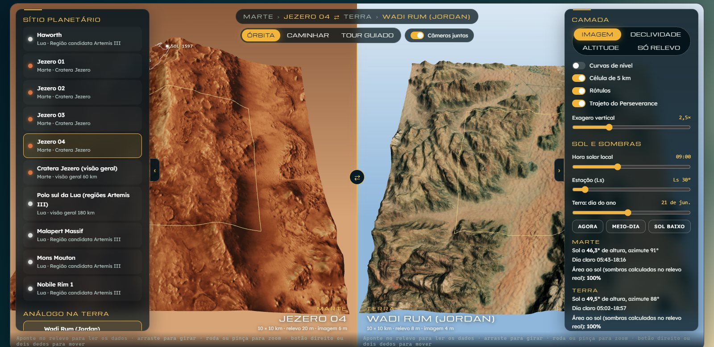
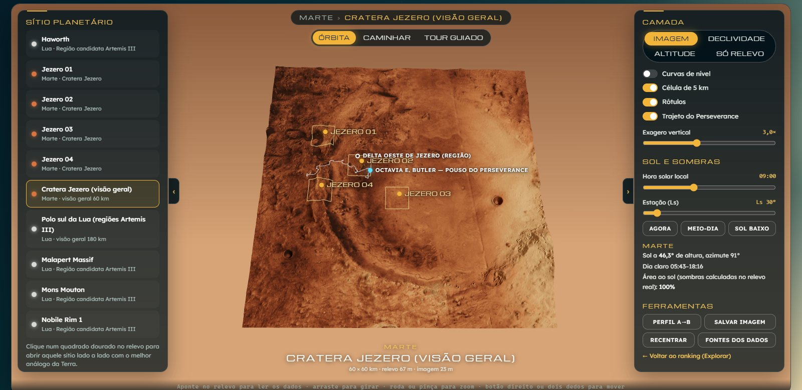

# ARA

**ARA finds places on Earth that resemble fixed Moon and Mars exploration sites — and shows, dimension by dimension, what is analogous, what is not, and where data is missing.**

NASA Space Apps Challenge 2026 · Challenge: *Identify Earth locations analogous to permanent base sites on the Moon and Mars.*

## What it does

- **Fixed planetary sites:** Jezero crater sectors 01–04 on Mars (Perseverance landing area) and Artemis III candidate regions at the lunar south pole. Each is a 5 × 5 km window at 100 m/pixel.
- **Dynamic Earth search:** a grid of 5 × 5 km Earth cells is ranked by terrain similarity. Users choose what the analog is *for* (default, rover mobility, landscape) or set their own weights, and the ranking updates instantly.
- **Analogous / not analogous:** every match shows per-dimension verdicts (slope, roughness, relief, temperature, mineralogy) plus the limits no Earth site can reproduce (gravity, atmosphere, radiation).
- **Data-quality simulation:** recomputes the same cells with lower resolution, missing data or elevation noise to show how much a conclusion depends on the data. Simulated results are always labelled.
- **Traceability:** every pipeline run writes `data/runs/<run_id>.json` with parameters, sources and requests. 

## 3D Lab — the twin view



The **3D Lab** (`#/3d`) puts a fixed planetary site and its Earth analog side by side, in **real relief at the same scale** (10 × 10 km windows, 5 km analysis cell outlined in gold), so you can *see* why the ranking says they are alike — and where they are not.

- **Real data, same grid for every body.** Mars: CTX 20 m DTM + 6 m orthomosaic of Jezero; colour from the Viking MDIM 2.1 mosaic (232 m) blended with Mars' mean Viking colour, since the local Viking tint near Isidis is biased blue-grey. Moon: LOLA 40 m polar DEM. Earth: AWS Terrain Tiles + Esri World Imagery. Every source is resampled into a local azimuthal-equidistant grid centred on the site (`pipeline/build_terrain3d.py`), so Jezero, the lunar south pole and Death Valley are metric and comparable.
- **Descent from orbit.** Opening a Mars or Moon site starts on a globe (Viking MDIM / LROC WAC mosaic) that turns to the site and descends with an altitude read-out, then hands over to the terrain.
- **Walk at HiRISE resolution.** "Local de pouso do Perseverance" is a 1.5 × 1.5 km scene from the HiRISE 1 m DTM and 25 cm orthomosaic around Octavia E. Butler Landing, opened directly in first-person walk mode with Mars gravity. On phones, walk mode has a virtual joystick, drag-to-look and jump/run buttons.
- **Mineral map.** On the Jezero scenes that overlap the western rim, the CRISM + CaSSIS mineral units of Valantinas et al. (2026) can be draped on the relief (bulk rim, weak/strong olivine, Fe/Mg phyllosilicates, LCP pyroxene), with the share of each class in the scene.
- **Test any place on Earth, live.** Pick a point on a map, type coordinates or choose a famous NASA/ESA analog (Haughton crater, MDRS Utah, Meteor Crater, Ries, Mauna Kea, Rio Tinto, Holuhraun…). The browser downloads Terrain Tiles + Esri imagery, builds the same 10 km scene, computes the three ARA measures at 100 m and says where that point would rank among the 710 Earth cells.
- **Synchronised twin cameras** — orbit one, the other follows.
- **Physical Sun for each body.** Local solar time + season (Ls on Mars, day of year on Earth, the ±1.54° lunar declination). Shadows are ray-cast on the real DEM (the same technique as lunar illumination maps), and the panel reports the **fraction of the cell in sunlight**. At Haworth (86.8° S) the Sun never rises above ~4.8°: long shadows, permanently shadowed craters.
- **Scientific layers** — imagery, slope classes for rover trafficability (< 5° easy · 15° Perseverance-class limit · > 35° steep), hypsometric tints, contour lines (10–250 m), vertical exaggeration 1–6×.
- **Elevation profile A → B** drawn on both terrains at once, with climb, descent and steepest stretch.
- **Guided tour** (static mode) that flies both cameras through the three ARA measures — slope, roughness, relief — with captions using the real numbers; **free orbit**; and **walk mode** — a game-like third-person astronaut in an EVA suit: W A S D/arrows move where the camera looks and the astronaut turns smoothly, Shift runs, Space jumps, drag to look around, mouse wheel zooms and C switches the camera (behind / from above / close); rocks (statistical model), footprints and ground texture appear as you walk; pick which side to walk on (mission or analog), expand it full width and come back — with each body's gravity: the same 2.5 m/s jump reaches 0.32 m on Earth, 0.84 m on Mars and 1.93 m on the Moon.
- **Perseverance traverse** (NASA/JPL MMGIS, sols 14 → 2022, 45 km) and sol markers draped on the Jezero scenes; **overview scenes** of the whole Jezero crater (60 km) and the lunar south pole (180 km) with clickable site boxes.
- **Cross-check:** the 3D scene recomputes the ARA measures at 100 m in the 5 km cell and shows them next to the catalogue values.
- **Twin Traverse** (tool *Travessia gêmea*). Click A and B on the mission terrain: the ARA plans the least-cost route (Dijkstra on a ~78 m grid) that never exceeds the mobility limit of the chosen mode — astronaut EVA (20°, Artemis III), Perseverance-class rover (30°) or Apollo LRV (25°) — and then searches the Earth analog for the stretch with the **same climbs and descents** (grade profile matched by RMS degrees). It reports length, climb, steepest stretch, time, share of the route in sunlight, Earth visibility for direct-to-Earth comms (Moon) and the **metabolic cost** (Pandolf 1977 with weight scaled by gravity): e.g. Jezero 01, 3.3 km → Death Valley twin with 4.4° RMS profile difference costs 2.9× the energy on Earth, so the rehearsal must use less load or partial weight offload to feel like the mission.
- **Operational window** (Moon, layer *Janela operacional*): every point coloured by how many Artemis III criteria it meets at the chosen hour — sunlight, Earth above the local horizon (ray-cast on the DEM, with adjustable libration) and slope < 10° for landing. At Haworth, noon: 55% of the scene meets all three.
- **Vehicles at real scale**: official NASA GLB models (Perseverance, Curiosity, Spirit/Opportunity, Ingenuity, Apollo Lunar Module, astronaut — public domain, loaded from science.nasa.gov) and simplified Sojourner and LRV built from published dimensions, placed on the terrain (`#/3d?site=haworth_01&veiculo=lrv`).
- Cursor read-out (lat, lon, elevation, slope), PNG snapshot of both views, data-source list per scene, and URLs that reopen a view (`#/3d?site=haworth_01&layer=declividade&hour=7.5&exag=3`).

| Lunar south pole, Sun at 3° | Slope classes + contours on Jezero |
| --- | --- |
|  |  |



## Explore: catalogue, discover, minerals — and the evidence behind each analog

The **Explorar** page has three modes.

- **Catálogo** — the 710-cell ranking (522 original cells + the Earth expansion below), now with filters on top, map + top candidates side by side and a details panel with tabs: *Resumo* (zoomable DEM image), *Comparação*, *Limitações*, *Fontes*, **Evidências** and **Robustez**.
- **Descobrir novo local (ARA Anywhere)** — pick any point on Earth (map, place search via Nominatim, coordinates or a famous NASA/ESA analog). The browser fetches, live and step by step: AWS Terrain Tiles (the same three ARA measures at 100 m in a 5 km cell), Macrostrat geology, NASA POWER monthly climatology, SoilGrids 0–5 cm texture with q05–q95 uncertainty and JRC surface-water history 1984–2021. The result is labelled **exploratory** and never mixed into the official ranking; it can be opened side by side in 3D.
- **Minerais** — Mars: CRISM + CaSSIS mineral units of Jezero's western rim (Valantinas et al. 2026), filterable by class, and the **THEMIS 2026 thermal-inertia** map (Huang 2026, MC-13) with the upper-limit quality band, histograms and per-sector values (they reproduce the team's delivery exactly: 292.8 / 236.2 / 244.7 / 249.9 J m⁻² K⁻¹ s⁻½). Earth: Macrostrat geology with a unit sheet on click. Moon: per-target evidence (LOLA, illumination, Diviner, M3) keeping unit, material, spectral signature, hydrogen and ice as separate categories.

**Evidence engine** (`src/lib/evidence/engine.js`, data from `pipeline/build_evidence.py` → `data/evidence/`): for every candidate and mission purpose (geomorphology, rover navigation, mineralogical instrument, geological training) each piece of evidence is *supporting*, *contradictory*, *unknown* or *context*, with origin (observed, derived, model estimate, contextual), source, resolution, period, rule and caveats. On top of it:

- **O que o ranking não mostra? (Analog Mirage)** — flags candidates whose relief passes the ranking but whose land cover, flood history or climate contradict the purpose (e.g. for Jezero 01 the #2 cell, Pinacate, is flagged; #1 Death Valley is not).
- **O que falta saber? (Next Best Measurement)** — a transparent purpose × evidence matrix splitting *what we know*, *what is missing* and *the next test to run* (e.g. sampling + granulometry + bevameter before a rover test). Rules, not probabilities.
- **Robustez** — position of the top candidates in 12 defined scenarios (3 weight sets × 4 data-quality versions).
- **Analog Passport** — JSON export with identification, target, characterization, interpretation, provenance and conclusion.

- **Pressão e temperatura** — the two things no desert reproduces, measured per pair: mission pressure (Mars: 6.1 hPa × e^(−h/11.1 km) with h from the site DEM; Moon: vacuum) against the analog's barometric pressure at its real altitude (Terrain Tiles), on a log scale with the Armstrong limit (63 hPa) and the EVA suit pressure (296 hPa); mission temperature (THEMIS brightness temperature on Mars, Diviner PRP on the Moon) against NASA POWER climatology, with the coldest month to rehearse in; gravity and load. Each row says how to close the gap in the rehearsal (pressurized suit/gloves, cold or thermal-vacuum chamber, weight offload).

Earth evidence for the 522 cells: ESA WorldCover 2021 (10 m), ISRIC SoilGrids 2.0 (250 m, model estimate), Macrostrat, NASA POWER (~0.5°, regional context) and JRC Global Surface Water (30 m). Mineral spectroscopy of Earth (NASA EMIT) is **not** integrated yet: it requires a NASA Earthdata login.

## Campo (Field Explorer)

`#/campo` turns a phone into a field companion: *use my location* (GPS via `watchPosition`, only while the session is active), *pick a point on the map* or *demonstration* (a clearly labelled simulated walk on real coordinates in Death Valley). It shows accuracy, a filtered track (fixes worse than 50 m or implying > 8 m/s are discarded), distance, Macrostrat geology re-queried only after 400 m, on-demand relief characterization against any of the 8 targets, missing data for the purpose, and **field notes** kept only on the device (exportable as JSON). Location is never sent anywhere except as the single point queried to the public data services.

## Missão (rover mission planner)

`#/missao` turns the real relief into a mission: pick a site (Jezero / Perseverance landing at HiRISE 1 m, the Artemis III south-pole regions, any Earth analog — or any point on Earth, live), a vehicle (Perseverance, Curiosity, Spirit/Opportunity, Apollo LRV) and the local solar hour, click **A** and **B**, and the ARA plans the safest route (Dijkstra/A* on a cost map, in the spirit of the JPL rovers' global planner — Carsten et al. 2007). Then **drive it yourself** with W A S D / arrows (C changes camera, space brakes), following the gold line or not.

- **Soil decides if you get stuck.** On Mars the "softness" of the ground comes from **THEMIS thermal inertia** (low inertia = fine grains / sand; Fergason et al. 2006); on Earth from **SoilGrids** sand and coarse-fragment fractions of the cell; on the Moon, loose regolith. Wheel slip grows with the climb and reaches 100% at the soil's critical angle (≈ 17° in loose sand, ≈ 28° on cohesive soil — MER and MSL mobility tests); sustained high slip sinks the wheels (Spirit at Troy, 2009).
- **Shadow decides if you can recharge.** Shadows are ray-cast on the DEM for the chosen hour; solar rovers only charge in sunlight, and the planner penalises shaded cells. The HUD warns "Na sombra: não pare aqui".
- **Energy, tipping and wheels.** P = m·g·v·(Crr·cosθ + sinθ)/η + fixed load; recharge by MMRTG (110 W) or panels; batteries from NASA/JPL and NSSDC (Perseverance 2 × 43 Ah; LRV 2 × 121 Ah, non-rechargeable). Tilt above 45° tips the rover; relief breaks larger than the ground clearance wear the wheels (Curiosity, 2013).
- **Mission report**: planned vs driven distance, time, energy and wheel wear, and the lesson behind each failure ("Você atolou", "Energia esgotada", "O rover tombou", "Rodas danificadas", "Missão cumprida"). The planning panel also compares the ARA route with the straight line.
- The fixed loads and drivetrain efficiencies are order-of-magnitude assumptions and are labelled as such; the DEM does not show rocks smaller than its pixel. Educational simulation, not NASA operations software.

### Mission v2 — strategies, sub-pixel rocks and planetary protection

- **Route panel (right) step by step**: pick A, pick B (clicks only count while a step is active, so rotating and zooming never set points by accident), or **Quick mission** (ARA picks a reachable A→B). The **Start** button is pinned at the bottom of the panel and also appears on the map toolbar (zoom +/−, recenter, hide panels). Both panels collapse.
- **Compare three strategies before driving** — *Fastest*, *Safest* and *Protects science* — each with length, time, energy, peak slip, shade, expected number of rocks taller than the wheel, metres inside science zones and new ground disturbed.
- **Rocks smaller than the DEM pixel** are generated with the **Golombek & Rapp (1997)** size-frequency model used by NASA/JPL for landing-site safety, F_k(D) = k·e^(−q(k)D), q(k) = 1.79 + 0.152/k, with rock height ≈ D/2. Rock cover k comes from THEMIS thermal inertia on Mars (1–12%, the "background terrain" range of HiRISE studies), from slope on the Moon (Diviner: little exposed rock except on steep slopes) and from SoilGrids coarse fragments on Earth. Rocks are drawn around the rover (instanced 3D) and the simulator uses the very same rocks: taller than the wheel diameter (rocker-bogie) or the chassis clearance (LRV) → blocked, medium ones → wheel wear.
- **Planetary protection (inspired by the team's PRISTINE proposal)**: science zones from CRISM aqueous-alteration units (Fe/Mg phyllosilicates, olivine + carbonate) on Jezero, **permanently shadowed regions** computed on the lunar DEM (ice that traps contaminants), or zones marked by the team; an adjustable disturbed band beyond the wheels (scenario parameter); a **temporal memory** of every traverse per site (saved in the browser) that the next plan sees and can reuse; and a report of the consequences (new ground disturbed, metres in science zones, share of reused tracks). References: NASA NID 8715.129, National Academies 2021, NASA 2022 human-Mars PP guidelines, Paiva & Sinibaldi 2025 (lunar PSR contamination).
- **Rock-free route corridor.** Like real planning on HiRISE rock maps, the planned route threads between rocks: inside the gold line's corridor (rover width/2 + 3 m) no rock tall enough to block or hurt a wheel is placed; outside it the statistical rock field applies and the HUD warns that you left the corridor. The planner also checks the steepest ramp inside each cell on the fine DEM, and the LRV turns with its real ~3 m radius.
- **Tested like a player**: the mission physics was run 480 times in the browser (8 site × vehicle cases × 20 runs × 3 driving styles: following the route, imprecise human, straight line) and 20 more missions were driven through the UI with the keyboard. Following the route, no run ended with damaged wheels or stuck; the routes that failed were refused by the planner (slopes above the vehicle limit) or ran out of time/energy on a 1 g Earth analog.
- **End report** that stays on screen ("Mission accomplished!" or the failure and its lesson) with planned vs driven numbers; a touch joystick for phones; sound and narration on events (if enabled in Settings).

## Settings, language and accessibility

`#/configuracoes` (also in the ☰ menu) and a **PT/EN** button in the header: site language (Portuguese / English — navigation, home, Explore, 3D panel, Data lab, Mission, Vehicles, About and Settings are bilingual; some long explanatory notes in Evidence, Discover, Minerals, Field and Analyses remain in Portuguese), text size (90–130%), high contrast, colour-blind safe palette (blue/orange instead of green/red), easier reading (letter, word and line spacing), underlined links, pause animations, narration and terrain sounds. Everything is stored only in the browser.

## Laboratório de dados — "how we got there"

`#/laboratorio` is a guided, 8-step scientific experiment on the **real DEM and image** of an Earth analog cell (5 × 5 km), compared with the mission site: original data → **pixel size** (20 → 500 m, block mean) → **vertical noise** → **data gaps** → **smoothing filter** → **edges (Sobel)** → **texture** (local standard deviation) → **what the data supports**. Original and processed are shown side by side (image, hillshade, slope, edges, texture); degraded data is always labelled *simulação*. The verdict re-extracts the three ARA measures on the processed grid, recomputes the ARA distance and says, per measure, whether the comparison is *sustentada*, *incerta* or *não sustentada* and why (pixel larger than the 100 m measurement scale, coverage < 80%, noise comparable to the real roughness, classification changed). A free mode exposes all controls. References: Zhang & Montgomery 1994, Grohmann 2015, Farr et al. 2007, Kirk et al. 2008, Horn 1981.

**Accessibility:** keyboard-operable controls, live text description of every result for screen readers, **narration** (Web Speech API, pt-BR) and **sonification** of the terrain (Web Audio API: pitch = elevation, hiss = roughness, silence = gap), playing the mission site, the original analog and the processed analog in sequence — no external service.

## Veículos (exploration fleet)

`#/veiculos` shows Sojourner, Spirit/Opportunity, Curiosity, Perseverance, Ingenuity, the Apollo LRV, the Lunar Module and an EVA astronaut in a 3D viewer at real scale next to a 1.75 m person, with specs, curiosities and **the lesson each one leaves for a crewed mission** (soft soil that trapped Spirit, sharp rocks that damaged Curiosity's wheels, MOXIE oxygen, Ingenuity as aerial scout, the Apollo walk-back rule). Each vehicle opens in the 3D Lab on real relief.

## Earth expansion (710 cells) and ML relief profiles

The Earth grid grew from 522 to **714 rows / 710 comparable cells** with three new 8 × 8 regions (100% valid coverage): **Holuhraun** (Iceland lava field), **Mauna Kea** (Hawaii) and **Erg Chebbi** (Sahara, Morocco). Same DEM (Terrarium z12 → local UTM, 100 m), same three measures, same formula, weights and scales; the 4 Prototype 1 reference rows stay in the file but out of the search. New leaders: Jezero 03 → `erg_chebbi_004003` (d 0.00239, −74%), Nobile Rim → `mauna_kea_005003` (d 0.07159, −25%); the other six sectors keep their leader. `tests/test_core.mjs` checks the 714 rows, 3 × 64 new cells and the Top 10 of all 8 sectors against the team's delivery (`data/source/ml_710/`).

An **unsupervised K-Means** (k = 2; 3 attributes: silhouette 0.725, ARI 0.945 vs the 518-cell model; 5 attributes with P90 slope/roughness: 0.705 / 0.929) groups the cells into *gentle* and *rugged* relief. It is shown in the analog details and in Analyses as **experimental context** — it never changes the ranking, group IDs are arbitrary and the names come from the physical centres. Limits: stability and simulated variants still cover only the original 522 cells, and the new cells have no geology context yet (the site says so).

## Method

For each 5 × 5 km window (100 m/pixel): mean slope (`np.gradient`), mean roughness (local standard deviation in a 3 × 3 window = 300 m) and relief (max − min). Similarity:

```
d = sqrt( Σ wᵢ · ((siteᵢ − cellᵢ) / scaleᵢ)² )     scales: 10°, 15 m, 500 m · default weights: 0.40 / 0.35 / 0.25
```

Stability: 2,000 random weight vectors, Dirichlet(1,1,1), seed 42 — sensitivity to weights, not the probability of a true analog. Same method as Prototype 1 (`mock/`), and the tests check that ARA reproduces Prototype 1's 16 distances and stability values exactly.

## Data

| Data | Use | Source |
| --- | --- | --- |
| Mars 2020 TRN CTX DTM mosaic, Jezero (20 m) | Mars terrain | NASA/USGS Astrogeology |
| Jezero Western Rim Mineral Maps v1.0 (CRISM) | Mars mineralogy context | Valantinas et al. (2026), Zenodo 10.5281/zenodo.22257754, CC BY 4.0 |
| LRO LOLA polar DEM (LDEM_80S_*MPP_ADJ) | Moon terrain | NASA Goddard PGDA (Barker et al.) |
| Artemis III candidate landing regions | Moon site list | NASA (Oct 2024) |
| Down Selected Artemis III Candidate Landing Site Navigational Grids | Moon site centres | USGS, McClernan (2024), doi:10.5066/P1MEQ6UK, CC0 |
| Mars Trek WMTS (Viking MDIM 2.1 colour mosaic) | Mars context map; colour of the 3D scenes | NASA Solar System Treks |
| Mars 2020 TRN CTX DTM 20 m + orthomosaic 6 m; JPL CTX DEM 20 m + ortho 5 m of Jezero crater | 3D Lab (Mars) | NASA/JPL-Caltech/MSSS, USGS Astrogeology |
| Perseverance traverse and waypoints | 3D Lab (Mars) | NASA/JPL-Caltech MMGIS |
| LOLA LDEM_80S_40MPP_ADJ | 3D Lab (Moon) | NASA Goddard PGDA (Barker et al. 2021) |
| Mapzen Terrain Tiles (z12; z14 in the 3D Lab) | Earth terrain grid and 3D relief | AWS Open Data |
| Macrostrat API v2 | Earth lithology context | macrostrat.org (CC BY 4.0) |
| GIBS (MODIS true colour) | Map layer | NASA GIBS |
| World Imagery | Basemap; imagery of the Earth 3D scenes | Esri |

## Repository

```
pipeline/   Python, run offline (terrain.py, moon_regions_from_usgs.py, build_earth_grid.py, build_moon_sites.py, build_catalog.py, stability.py, build_simulation.py, enrich_context.py)
data/       JSON outputs read by the app (+ img/, terrain/ 3D scenes, source/ deliveries, runs/ trace logs)
src/        React app (Vite + Tailwind v4 + React Router)
  pages/        Home, Explore, Lab3D (3D twin view), Analyses, About (one file per route)
  components/   layout/ (Header, Footer, BrandMark), home/, explore/, ui/ (Pill, Card, StatusChip, Segmented, Icons)
  hooks/        useAraData (fetches data/*.json once), useExplorer (shared state), useRanking, useHighContrast
  lib/          core.js (ranking maths, tested), format.js (pt-BR formatting, labels)
  lib/terrain3d/ TerrainView (three.js renderer), data.js (scene loading, heights, profiles), sun.js (Sun position per body, ray-cast shadows)
  components/fx/ Sky (stars, shooting stars, mouse parallax); home/GlobeCanvas uses lib/globe.js (360° rotating planets)
  assets/css/   ara.css: Tailwind import + design tokens (@theme) + shared classes · home.css: home page, top bar, animations
  assets/img/   logo, horizon, Mars/Moon equirectangular textures (tools/make_globe_texture.py)
  public/       favicon and other static files copied as-is
web/        build output (generated by `npm run build` / GitHub Actions; not committed)
mock/       Prototype 1 (HTML v7.3 + Colab notebook), reference only
tests/      python tests/test_pipeline.py · node tests/test_core.mjs
```

## Run it

```bash
pip install -r pipeline/requirements.txt
python pipeline/convert_mock.py            # Prototype 1 data -> data/ (example grid)
python pipeline/import_delivery.py --moon <ARA_Lua/ARA> --mars <ARA_Marte/ARA>   # team deliveries -> data/source, data/img
python pipeline/build_earth_grid.py --region atacama
python pipeline/moon_regions_from_usgs.py --folder <USGS data release>   # fills Moon site centres
python pipeline/build_moon_sites.py --dem LDEM_80S_40MPP_ADJ.TIF
python pipeline/build_catalog.py
python pipeline/stability.py
python pipeline/enrich_context.py --top 50
python pipeline/build_simulation.py --mars-tif jezero_01=.../jezero_01_dem_100m.tif
python pipeline/build_evidence.py           # WorldCover, SoilGrids, Macrostrat, POWER, JRC for the 522 cells -> data/evidence/
python pipeline/build_minerals.py           # CRISM units + THEMIS 2026 thermal inertia of Jezero -> data/minerals/
python pipeline/build_terrain3d.py          # 3D scenes -> data/terrain/ (reads only the needed windows from the public servers)
```

Front end (Node 22):

```bash
npm install
npm run dev       # http://localhost:5173 — hot reload; data/ is served directly, so pipeline output shows up on refresh
npm test          # ranking logic against Prototype 1 numbers
npm run build     # builds into web/ and copies data/ to web/data/ (what GitHub Pages serves)
npm run preview   # serves the built web/ to check it before pushing
```

Deploy: every push to `main` runs `.github/workflows/pages.yml` (npm ci → npm test → npm run build → publish `web/`). Routes use a hash (`#/explorar`), so they work on GitHub Pages without extra config.

## Design

Colours: deep petrol blue `#071d24 → #123a40` fading to sage `#8fa98f`, gold accent `#f2b53a`, ink `#f4f1e8`. Fonts: Michroma (headings, logo) and Lexend (text), bundled via @fontsource. Design tokens live in the `@theme` block of `src/assets/css/ara.css` and are used as Tailwind classes (`bg-petrol-900`, `text-gold`, `font-display`…), so changing a colour there changes it everywhere. The home page (by Alessandra) mirrors the 1600 × 900 reference art: Mars and the Moon rotate 360° on canvas from equirectangular textures, with a starfield, occasional shooting star and light mouse parallax. "Pausar animações" in the ☰ menu (or the system's reduced-motion setting) stops all motion; "Alto contraste" switches to a black/yellow theme.

## Use of AI (disclosure)

- **Code and text:** parts of the code, interface text, documentation and the consolidated report were written or reviewed with AI assistants (Anthropic **Claude Code** and **GitHub Copilot**). Every change was reviewed by the team and checked by the automated tests (`npm test`) and browser tests.
- **Data:** the scientific data are **not** AI-generated. They come from the public sources listed in [Data](#data); AI only helped write the code that downloads and processes them. The K-Means relief profiles are a classical, unsupervised machine-learning method trained by the team on those data (labelled *experimental* on the site).
- **Audio and video:** the 30-second pitch video uses an **AI-generated synthetic voice** (Microsoft Edge neural TTS via edge-tts). The background music was composed programmatically for the project.
- **Images:** the site screenshots are real captures of the platform; no AI image generator was used for the site's data views.
- **NASA branding:** ARA does not use NASA logos, flags or mission emblems. The official NASA 3D models carry them in their textures, so the loader covers those areas (`src/lib/terrain3d/models.js`). ARA is not an official NASA product.

## Limitations

Three summary statistics do not capture slope orientation, drainage or multi-scale texture. Weights and scales are not calibrated against expert labels. Earth and planetary DEMs come from different instruments with different vertical accuracy. Mapped lithology is not verified mineralogy, and 0% CRISM coverage means no map overlap, not absence of minerals. Earth cannot reproduce lunar/Martian gravity, vacuum or thin atmosphere, or radiation.
