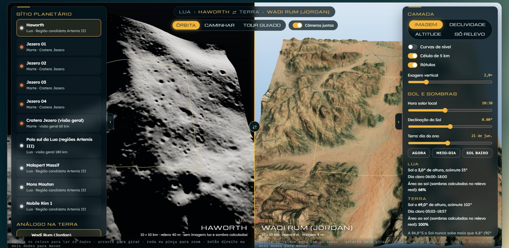
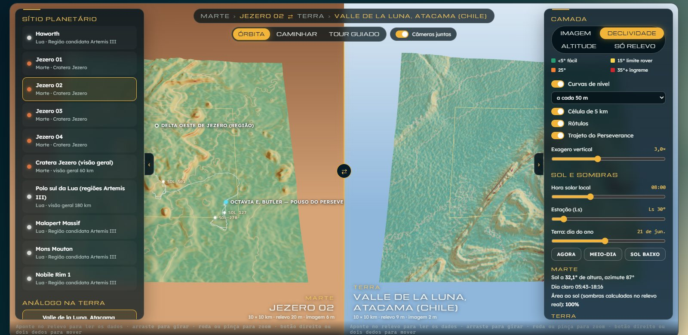

# ARA

**ARA finds places on Earth that resemble fixed Moon and Mars exploration sites — and shows, dimension by dimension, what is analogous, what is not, and where data is missing.**

NASA Space Apps Challenge 2026 · Challenge: *Identify Earth locations analogous to permanent base sites on the Moon and Mars.*

## What it does

- **Fixed planetary sites:** Jezero crater sectors 01–04 on Mars (Perseverance landing area) and Artemis III candidate regions at the lunar south pole. Each is a 5 × 5 km window at 100 m/pixel.
- **Dynamic Earth search:** a grid of 5 × 5 km Earth cells is ranked by terrain similarity. Users choose what the analog is *for* (default, rover mobility, landscape) or set their own weights, and the ranking updates instantly.
- **Analogous / not analogous:** every match shows per-dimension verdicts (slope, roughness, relief, temperature, mineralogy) plus the limits no Earth site can reproduce (gravity, atmosphere, radiation).
- **Data-quality simulation:** recomputes the same cells with lower resolution, missing data or elevation noise to show how much a conclusion depends on the data. Simulated results are always labelled.
- **Traceability:** every pipeline run writes `data/runs/<run_id>.json` with parameters, sources and requests.

## 3D Lab — the twin view


The **3D Lab** (`#/3d`) puts a fixed planetary site and its Earth analog side by side, in **real relief at the same scale** (10 × 10 km windows, 5 km analysis cell outlined in gold), so you can *see* why the ranking says they are alike — and where they are not.

- **Real data, same grid for every body.** Mars: CTX 20 m DTM + 6 m orthomosaic of Jezero, coloured with the Viking MDIM mosaic. Moon: LOLA 40 m polar DEM. Earth: AWS Terrain Tiles + Esri World Imagery. Every source is resampled into a local azimuthal-equidistant grid centred on the site (`pipeline/build_terrain3d.py`), so Jezero, the lunar south pole and Death Valley are metric and comparable.
- **Synchronised twin cameras** — orbit one, the other follows.
- **Physical Sun for each body.** Local solar time + season (Ls on Mars, day of year on Earth, the ±1.54° lunar declination). Shadows are ray-cast on the real DEM (the same technique as lunar illumination maps), and the panel reports the **fraction of the cell in sunlight**. At Haworth (86.8° S) the Sun never rises above ~4.8°: long shadows, permanently shadowed craters.
- **Scientific layers** — imagery, slope classes for rover trafficability (< 5° easy · 15° Perseverance-class limit · > 35° steep), hypsometric tints, contour lines (10–250 m), vertical exaggeration 1–6×.
- **Elevation profile A → B** drawn on both terrains at once, with climb, descent and steepest stretch.
- **Guided tour** (static mode) that flies both cameras through the three ARA measures — slope, roughness, relief — with captions using the real numbers; **free orbit**; and **walk mode** (first person, W A S D, Shift, Space) with each body's gravity: the same 2.5 m/s jump reaches 0.32 m on Earth, 0.84 m on Mars and 1.93 m on the Moon.
- **Perseverance traverse** (NASA/JPL MMGIS, sols 14 → 2022, 45 km) and sol markers draped on the Jezero scenes; **overview scenes** of the whole Jezero crater (60 km) and the lunar south pole (180 km) with clickable site boxes.
- **Cross-check:** the 3D scene recomputes the ARA measures at 100 m in the 5 km cell and shows them next to the catalogue values.
- Cursor read-out (lat, lon, elevation, slope), PNG snapshot of both views, data-source list per scene, and URLs that reopen a view (`#/3d?site=haworth_01&layer=declividade&hour=7.5&exag=3`).

| Lunar south pole, Sun at 3° | Slope classes + contours on Jezero |
| --- | --- |
|  |  |


## Method

For each 5 × 5 km window (100 m/pixel): mean slope (`np.gradient`), mean roughness (local standard deviation in a 3 × 3 window = 300 m) and relief (max − min). Similarity:

```
d = sqrt( Σ wᵢ · ((siteᵢ − cellᵢ) / scaleᵢ)² )     scales: 10°, 15 m, 500 m · default weights: 0.40 / 0.35 / 0.25
```

Stability: 2,000 random weight vectors, Dirichlet(1,1,1), seed 42 — sensitivity to weights, not the probability of a true analog. Same method as Prototype 1 (`mock/`), and the tests check that ARA reproduces Prototype 1's 16 distances and stability values exactly.

## Data

| Data | Use | Source |
| --- | --- | --- |
| Mars 2020 TRN CTX DTM mosaic, Jezero (20 m) | Mars terrain | NASA/USGS Astrogeology |
| Jezero Western Rim Mineral Maps v1.0 (CRISM) | Mars mineralogy context | Valantinas et al. (2026), Zenodo 10.5281/zenodo.22257754, CC BY 4.0 |
| LRO LOLA polar DEM (LDEM_80S_*MPP_ADJ) | Moon terrain | NASA Goddard PGDA (Barker et al.) |
| Artemis III candidate landing regions | Moon site list | NASA (Oct 2024) |
| Down Selected Artemis III Candidate Landing Site Navigational Grids | Moon site centres | USGS, McClernan (2024), doi:10.5066/P1MEQ6UK, CC0 |
| Mars Trek WMTS (Viking MDIM 2.1 colour mosaic) | Mars context map; colour of the 3D scenes | NASA Solar System Treks |
| Mars 2020 TRN CTX DTM 20 m + orthomosaic 6 m; JPL CTX DEM 20 m + ortho 5 m of Jezero crater | 3D Lab (Mars) | NASA/JPL-Caltech/MSSS, USGS Astrogeology |
| Perseverance traverse and waypoints | 3D Lab (Mars) | NASA/JPL-Caltech MMGIS |
| LOLA LDEM_80S_40MPP_ADJ | 3D Lab (Moon) | NASA Goddard PGDA (Barker et al. 2021) |
| Mapzen Terrain Tiles (z12; z14 in the 3D Lab) | Earth terrain grid and 3D relief | AWS Open Data |
| Macrostrat API v2 | Earth lithology context | macrostrat.org (CC BY 4.0) |
| GIBS (MODIS true colour) | Map layer | NASA GIBS |
| World Imagery | Basemap; imagery of the Earth 3D scenes | Esri |

## Repository

```
pipeline/   Python, run offline (terrain.py, moon_regions_from_usgs.py, build_earth_grid.py, build_moon_sites.py, build_catalog.py, stability.py, build_simulation.py, enrich_context.py)
data/       JSON outputs read by the app (+ img/, terrain/ 3D scenes, source/ deliveries, runs/ trace logs)
src/        React app (Vite + Tailwind v4 + React Router)
  pages/        Home, Explore, Lab3D (3D twin view), Analyses, About (one file per route)
  components/   layout/ (Header, Footer, BrandMark), home/, explore/, ui/ (Pill, Card, StatusChip, Segmented, Icons)
  hooks/        useAraData (fetches data/*.json once), useExplorer (shared state), useRanking, useHighContrast
  lib/          core.js (ranking maths, tested), format.js (pt-BR formatting, labels)
  lib/terrain3d/ TerrainView (three.js renderer), data.js (scene loading, heights, profiles), sun.js (Sun position per body, ray-cast shadows)
  components/fx/ Sky (stars, shooting stars, mouse parallax); home/GlobeCanvas uses lib/globe.js (360° rotating planets)
  assets/css/   ara.css: Tailwind import + design tokens (@theme) + shared classes · home.css: home page, top bar, animations
  assets/img/   logo, horizon, Mars/Moon equirectangular textures (tools/make_globe_texture.py)
  public/       favicon and other static files copied as-is
web/        build output (generated by `npm run build` / GitHub Actions; not committed)
mock/       Prototype 1 (HTML v7.3 + Colab notebook), reference only
tests/      python tests/test_pipeline.py · node tests/test_core.mjs
```

## Run it

```bash
pip install -r pipeline/requirements.txt
python pipeline/convert_mock.py            # Prototype 1 data -> data/ (example grid)
python pipeline/import_delivery.py --moon <ARA_Lua/ARA> --mars <ARA_Marte/ARA>   # team deliveries -> data/source, data/img
python pipeline/build_earth_grid.py --region atacama
python pipeline/moon_regions_from_usgs.py --folder <USGS data release>   # fills Moon site centres
python pipeline/build_moon_sites.py --dem LDEM_80S_40MPP_ADJ.TIF
python pipeline/build_catalog.py
python pipeline/stability.py
python pipeline/enrich_context.py --top 50
python pipeline/build_simulation.py --mars-tif jezero_01=.../jezero_01_dem_100m.tif
python pipeline/build_terrain3d.py          # 3D scenes -> data/terrain/ (reads only the needed windows from the public servers)
```

Front end (Node 22):

```bash
npm install
npm run dev       # http://localhost:5173 — hot reload; data/ is served directly, so pipeline output shows up on refresh
npm test          # ranking logic against Prototype 1 numbers
npm run build     # builds into web/ and copies data/ to web/data/ (what GitHub Pages serves)
npm run preview   # serves the built web/ to check it before pushing
```

Deploy: every push to `main` runs `.github/workflows/pages.yml` (npm ci → npm test → npm run build → publish `web/`). Routes use a hash (`#/explorar`), so they work on GitHub Pages without extra config.

## Design

Colours: deep petrol blue `#071d24 → #123a40` fading to sage `#8fa98f`, gold accent `#f2b53a`, ink `#f4f1e8`. Fonts: Michroma (headings, logo) and Lexend (text), bundled via @fontsource. Design tokens live in the `@theme` block of `src/assets/css/ara.css` and are used as Tailwind classes (`bg-petrol-900`, `text-gold`, `font-display`…), so changing a colour there changes it everywhere. The home page (by Alessandra) mirrors the 1600 × 900 reference art: Mars and the Moon rotate 360° on canvas from equirectangular textures, with a starfield, occasional shooting star and light mouse parallax. "Pausar animações" in the ☰ menu (or the system's reduced-motion setting) stops all motion; "Alto contraste" switches to a black/yellow theme.

## Limitations

Three summary statistics do not capture slope orientation, drainage or multi-scale texture. Weights and scales are not calibrated against expert labels. Earth and planetary DEMs come from different instruments with different vertical accuracy. Mapped lithology is not verified mineralogy, and 0% CRISM coverage means no map overlap, not absence of minerals. Earth cannot reproduce lunar/Martian gravity, vacuum or thin atmosphere, or radiation.

## Use of AI

<!-- Fill in before submitting: which tools, where, how. Mark AI-generated images with a visible watermark. -->
